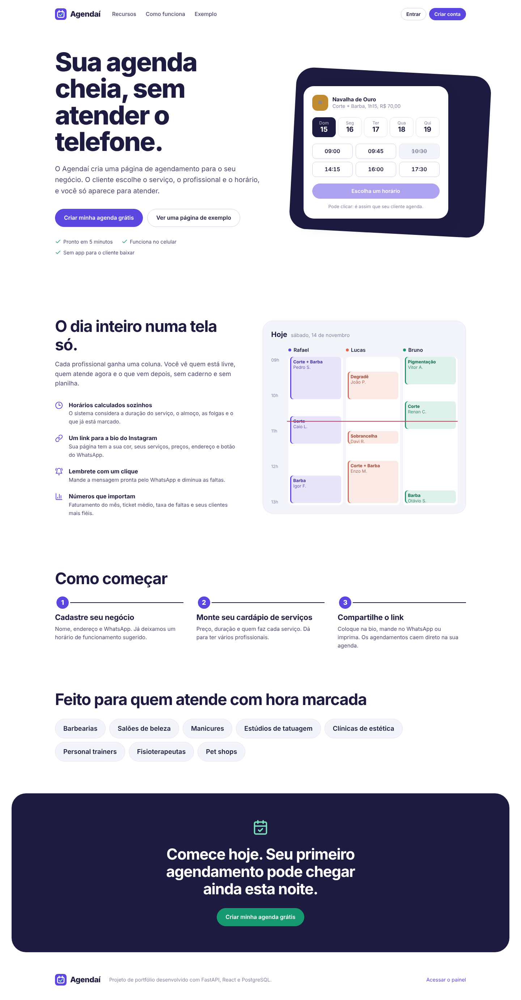
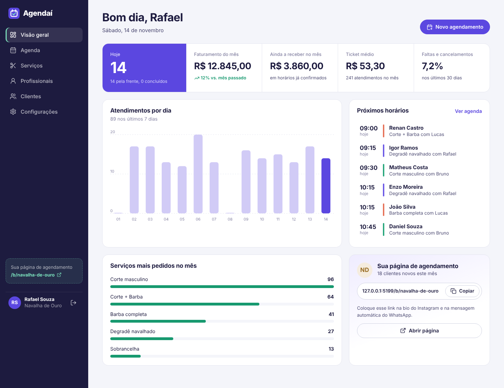
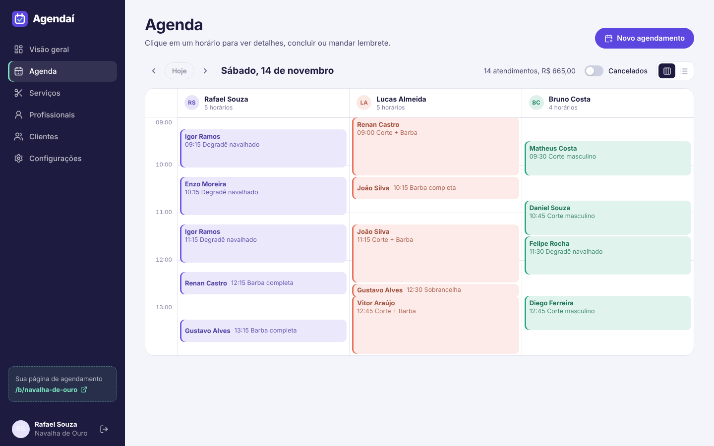
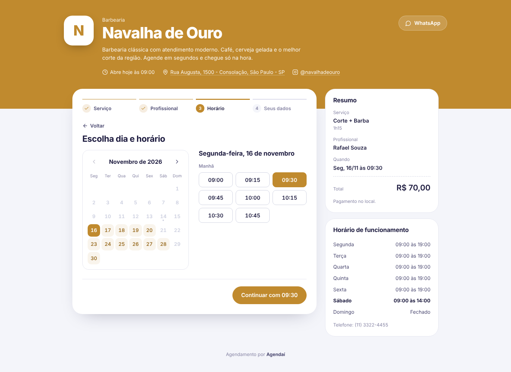
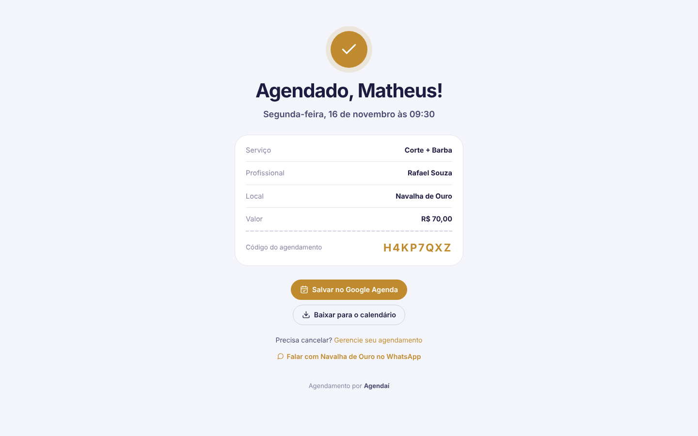
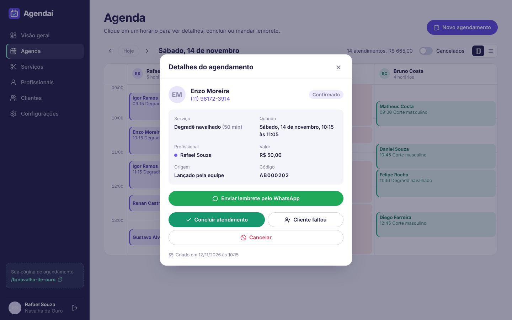
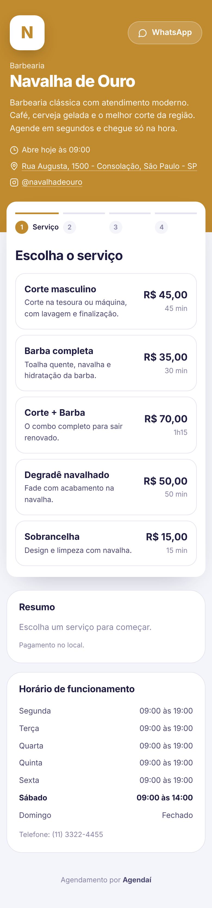
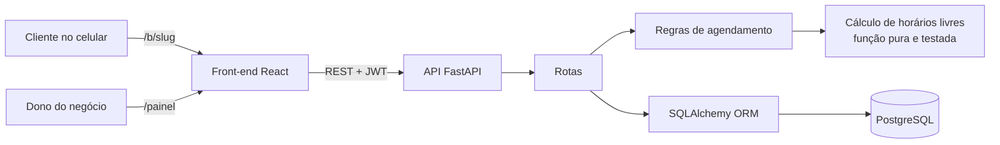

<h1 align="center">Agendaí</h1>

<p align="center">
  <strong>Sistema de agendamento online para pequenos negócios</strong><br/>
  Barbearias, salões, clínicas e estúdios ganham uma página própria onde o cliente marca o horário sozinho,<br/>
  e um painel para organizar a agenda, os clientes e o faturamento.
</p>

<p align="center">
  
  
  
  
  
</p>



## Sobre o projeto

Muito pequeno negócio ainda marca horário pelo WhatsApp, um por um. O dono perde tempo respondendo
mensagem, esquece encaixes e não sabe quanto faturou no mês.

O **Agendaí** resolve isso com duas partes:

- **Página pública de agendamento** (`/b/nome-do-negocio`): o cliente escolhe o serviço, o profissional,
  o dia e o horário, e recebe um código para gerenciar ou cancelar.
- **Painel do negócio**: agenda do dia em colunas por profissional, cadastro de serviços e equipe,
  horário de funcionamento, folgas, lista de clientes e indicadores do mês.

## Funcionalidades

**Para o cliente**
- Fluxo de agendamento em 4 etapas, pensado para o celular
- Calendário que mostra só os dias com horários livres
- Horários agrupados em manhã, tarde e noite
- Opção "qualquer profissional" (o sistema escolhe quem está com a agenda mais livre)
- Confirmação com código, botão para salvar no Google Agenda e arquivo `.ics`
- Página para consultar e cancelar o agendamento pelo código
- Lembra os dados do cliente no aparelho (opcional)

**Para o negócio**
- Cadastro com criação automática do negócio e horário sugerido
- Dashboard: atendimentos do dia, faturamento do mês com comparação ao mês anterior, valor a receber,
  ticket médio, taxa de faltas e cancelamentos, gráfico dos últimos 14 dias e serviços mais pedidos
- Agenda visual em grade (uma coluna por profissional, linha do "agora", intervalo de almoço) ou em lista
- Concluir atendimento, marcar falta, cancelar e enviar **lembrete pronto pelo WhatsApp**
- Lançamento manual de agendamentos (telefone, balcão)
- Serviços com preço, duração e quem realiza; profissionais com cor própria na agenda
- Horário de funcionamento por dia da semana, com intervalo
- Folgas e bloqueios (por profissional ou do negócio inteiro)
- Lista de clientes com visitas, total gasto, próxima visita e alerta de cliente sumido
- Personalização da página: cor, link, descrição, Instagram e endereço com prévia ao vivo

## Telas

| Painel | Agenda do dia |
| --- | --- |
|  |  |

| Escolha de dia e horário | Confirmação |
| --- | --- |
|  |  |

| Detalhes do agendamento | No celular |
| --- | --- |
|  |  |

## Tecnologias

| Camada | Tecnologias |
| --- | --- |
| Back-end | Python, FastAPI, SQLAlchemy 2.0, Pydantic v2, JWT (PyJWT), bcrypt |
| Banco de dados | PostgreSQL em produção, SQLite em desenvolvimento |
| Front-end | React 19, Vite, React Router, Day.js, CSS puro com design tokens |
| Testes | Pytest (regras de negócio e testes de API ponta a ponta) |
| Infra | Docker, Docker Compose, Nginx, GitHub Actions (CI) |

## Arquitetura



```
agendai/
├── backend/
│   ├── app/
│   │   ├── main.py              # cria a API e registra as rotas
│   │   ├── models.py            # tabelas do banco
│   │   ├── schemas.py           # validação de entrada e saída
│   │   ├── security.py          # senhas (bcrypt) e tokens (JWT)
│   │   ├── routers/             # auth, negócio, catálogo, agenda, clientes, dashboard, público
│   │   ├── services/
│   │   │   ├── availability.py  # cálculo de horários livres (sem banco)
│   │   │   └── booking.py       # regras de agendamento
│   │   └── seed.py              # dados de demonstração
│   └── tests/
├── frontend/
│   └── src/
│       ├── pages/               # landing, login, painel, página pública
│       ├── components/          # modal, calendário, gráfico, etc.
│       ├── context/             # autenticação e avisos (toasts)
│       └── styles/              # tokens e estilos
└── docker-compose.yml
```

## Decisões técnicas

- **Cálculo de horários isolado.** A regra mais importante do sistema (quais horários estão livres)
  fica em uma função pura em `services/availability.py`. Ela considera duração do serviço, intervalo de
  almoço, agendamentos existentes, folgas e antecedência mínima, e é coberta por testes sem precisar
  de banco.
- **Uma consulta por período.** Para montar o calendário do mês, a API carrega de uma vez os
  agendamentos e bloqueios do período, em vez de consultar o banco dia a dia.
- **Distribuição de clientes.** Na opção "qualquer profissional", o sistema escolhe quem tem menos
  atendimentos no dia.
- **Dados isolados por negócio.** Toda rota do painel filtra pelo negócio do usuário logado; tentar
  acessar o registro de outro negócio retorna 404 (há teste para isso).
- **Histórico preservado.** Serviços e profissionais com agendamentos não podem ser excluídos, só
  desativados.
- **Preço congelado.** O agendamento guarda o preço do momento da reserva, então mudar a tabela de
  preços não altera o faturamento passado.

## Como rodar no seu computador

**Pré-requisitos:** [Python 3.11+](https://www.python.org/downloads/) e [Node.js 20+](https://nodejs.org/).

### Jeito rápido (Windows)

Dê dois cliques em `backend/iniciar.bat` e depois em `frontend/iniciar.bat`.
O primeiro cria o ambiente, instala tudo e já cria a barbearia de demonstração.

### Passo a passo (qualquer sistema)

```bash
# 1. API
cd backend
python -m venv .venv
.venv\Scripts\activate          # Windows
# source .venv/bin/activate     # Linux/Mac
pip install -r requirements.txt
copy .env.example .env          # Linux/Mac: cp .env.example .env
python -m app.seed              # cria a conta de demonstração
uvicorn app.main:app --reload   # http://localhost:8000/docs

# 2. Front-end (em outro terminal)
cd frontend
npm install
npm run dev                     # http://localhost:5173
```

### Com Docker

```bash
docker compose up --build
```

Front-end em http://localhost:8080 e documentação da API em http://localhost:8000/docs.

### Conta de demonstração

| | |
| --- | --- |
| E-mail | `demo@agendai.com` |
| Senha | `demo123` |
| Página pública | http://localhost:5173/b/navalha-de-ouro |

Na tela de login também existe o botão **Entrar na conta de demonstração**.

## Testes

```bash
cd backend
pytest -v
```

Os testes cobrem o cálculo de horários (duração, almoço, passado, bloqueios) e o fluxo completo pela
API: cadastro, login, serviço, agendamento, conflito de horário, cancelamento, bloqueios e isolamento
entre negócios. O GitHub Actions roda os testes e o build do front a cada push.

## Principais rotas da API

A documentação interativa completa fica em `/docs` (Swagger).

| Método | Rota | Descrição |
| --- | --- | --- |
| POST | `/api/auth/register` | Cria conta e negócio |
| POST | `/api/auth/login` | Login, retorna JWT |
| GET | `/api/dashboard` | Indicadores do painel |
| GET | `/api/appointments?start=AAAA-MM-DD` | Agenda do dia ou período |
| PATCH | `/api/appointments/{id}/status` | Concluir, marcar falta, cancelar |
| GET/POST/PUT/DELETE | `/api/services` | Serviços |
| GET/POST/PUT/DELETE | `/api/professionals` | Profissionais |
| PUT | `/api/business/hours` | Horário de funcionamento |
| GET/POST/DELETE | `/api/time-off` | Folgas e bloqueios |
| GET | `/api/customers` | Clientes com histórico |
| GET | `/api/public/business/{slug}` | Dados da página pública |
| GET | `/api/public/business/{slug}/calendar` | Dias com horário livre |
| GET | `/api/public/business/{slug}/availability` | Horários livres de um dia |
| POST | `/api/public/business/{slug}/appointments` | Cliente agenda |
| POST | `/api/public/appointments/{code}/cancel` | Cliente cancela |

## Próximos passos

- [ ] Pagamento antecipado via Pix (Mercado Pago)
- [ ] Lembrete automático por e-mail e WhatsApp (API oficial)
- [ ] Migrações de banco com Alembic
- [ ] Bloqueio de horário com trava no banco para acessos simultâneos
- [ ] Relatórios exportáveis em Excel

## Autor

Feito por **Matheus**, estudante de Análise e Desenvolvimento de Sistemas.

- LinkedIn: _adicione seu link aqui_
- GitHub: _adicione seu link aqui_
